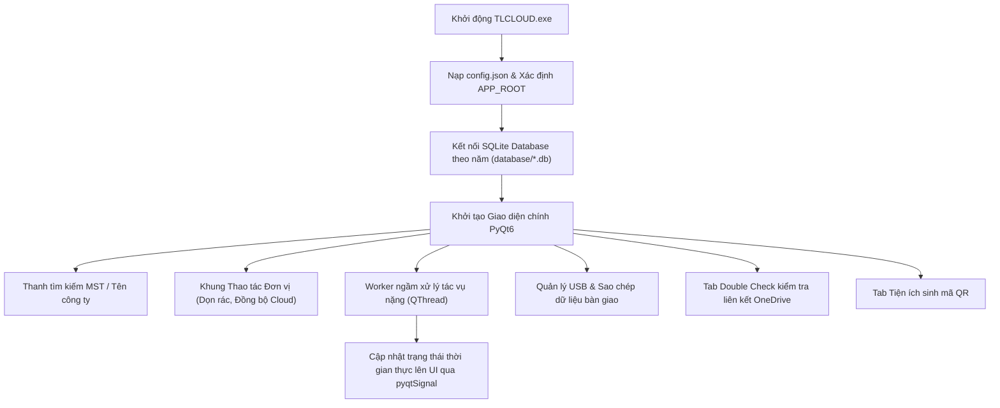

# 🧠 BẢN THIẾT KẾ HỆ THỐNG CODE (SYSTEM ARCHITECTURE BLUEPRINT)

- **Tên dự án**: Tool TL - CLOUD
- **Phiên bản hiện tại**: `1.3.1`
- **Cập nhật gần nhất**: 2026-10-16
- **Mã nguồn GitHub**: [https://github.com/lampython/TL-Admin-TLCLOUD.git](https://github.com/lampython/TL-Admin-TLCLOUD.git)

---

## 🎯 1. MỤC ĐÍCH HỆ THỐNG (CORE MISSION)
Hệ thống **TL - CLOUD** là giải pháp phần mềm chuyên dụng hỗ trợ quản lý dữ liệu doanh nghiệp, kiểm tra đồng bộ đám mây (OneDrive), tạo mã QR và bàn giao dữ liệu an toàn phục vụ nghiệp vụ của **Công ty TNHH Tư vấn & Dịch vụ Thuế TL**:
- Quản lý cơ sở dữ liệu khách hàng theo từng năm tài chính (2024, 2025, 2026...).
- Dọn dẹp tệp tin rác/tạm và đồng bộ hai chiều với kho lưu trữ đám mây.
- Hỗ trợ kết xuất và format an toàn dữ liệu ra USB để bàn giao cho khách hàng.
- Tính năng Double Check phát hiện sớm các liên kết OneDrive bị đứt gãy hoặc lỗi cấp phép.
- Hỗ trợ triển khai đa môi trường: máy tính cá nhân (Desktop Standalone) và máy chủ nội bộ (NAS SMB Share `\\nastl\TL\...`).

---

## 📂 2. BẢN ĐỒ CẤU TRÚC THƯ MỤC & MODULES (FOLDER MAP)

```text
[project-root]/
├── README.md               # 📖 Hướng dẫn sử dụng chi tiết & Bản đồ nút bấm
├── SYSTEM.md               # 🧠 Bản thiết kế kiến trúc hệ thống code (AI & Dev)
├── VERSION                 # 🏷️ Phiên bản hiện tại (1.3.1)
├── CHANGELOG.md            # 📜 Lịch sử thay đổi qua từng phiên bản
├── TLCLOUD.py              # 🚀 Mã nguồn chính (Giao diện PyQt6 + Core Logic)
├── TLCLOUD.spec            # 📦 File cấu hình đóng gói PyInstaller
├── build.bat               # ⚙️ Script đóng gói tự động chế độ Onedir
├── chay_phan_mem.bat       # 🚀 Launcher khởi chạy nhanh ứng dụng
├── config.json             # ⚙️ File cấu hình tham số hệ thống
├── icon.ico                # 🎨 Biểu tượng ứng dụng Windows
├── requirements.txt        # 📦 Danh sách dependencies Python
│
├── database/               # 💾 Cơ sở dữ liệu SQLite theo niên độ
│   ├── DANH SACH THE 2024.db
│   └── DANH SACH THE 2025.db
│
├── dist/                   # 📦 Bản build PyInstaller (TLCLOUD.exe + _internal)
│   └── TLCLOUD/
└── build/                  # 🔨 Thư mục tạm thời của PyInstaller
```

---

## 🔄 3. LUỒNG HOẠT ĐỘNG CHÍNH (WORKFLOW & DATA FLOW)



---

## 🛠️ 4. TECH STACK & DEPENDENCIES
- **Ngôn ngữ & Runtime**: Python 3.11+
- **Giao diện (UI)**: PyQt6 (QApplication, QMainWindow, QThread, pyqtSignal, QCompleter)
- **Cơ sở dữ liệu**: SQLite3 (Quản trị theo niên độ trong thư mục `database/`)
- **Xử lý bảng tính & Dữ liệu**: Pandas, OpenPyXL, XlsxWriter
- **Tiện ích**: QRCode, Pillow, Requests
- **Đóng gói phân phối**: PyInstaller (Chế độ `--onedir` tối ưu nạp nhanh)

---

## 📊 5. TRẠNG THÁI TÍNH NĂNG (FEATURE STATUS)
- [x] Quản lý & tra cứu dữ liệu doanh nghiệp thời gian thực
- [x] Tự động dọn rác và đồng bộ đám mây
- [x] Bàn giao dữ liệu qua thiết bị lưu trữ USB
- [x] Kiểm tra liên kết OneDrive (Double Check)
- [x] Sinh mã QR offline theo định dạng chuẩn
- [x] Tương thích và vận hành mượt mà trên môi trường ổ mạng chia sẻ (NAS)
- [ ] Mở rộng đồng bộ tự động đa đám mây

---

## ⚠️ 6. QUY TẮC ĐẶC THÙ & LƯU Ý KỸ THUẬT
- **Triển khai trên NAS**: Khi cập nhật bản build mới lên máy chủ NAS (`\\nastl\TL\...`), tuyệt đối **không chép đè hòa trộn (merge)**. Phải xóa sạch thư mục `_internal` cũ trước khi sao chép thư mục `_internal` mới để tránh lỗi xung đột tàn dư namespace package (như `pytz`).
- **Đường dẫn Portable**: Sử dụng hàm `get_app_root()` linh hoạt dựa trên `getattr(sys, 'frozen', False)` để đảm bảo phần mềm luôn định vị đúng file `database/` và `config.json` bất kể chạy qua Python script hay chạy trực tiếp từ file `.exe` trên mạng nội bộ.
- **Bảo toàn dữ liệu**: Thư mục `database/` và file `config.json` chứa dữ liệu vận hành sống, phải luôn được bảo vệ khi bảo trì hoặc nâng cấp hệ thống.
